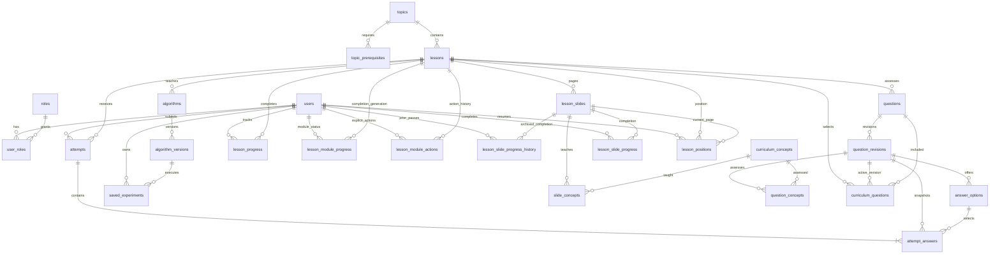

# Database design

MySQL 8.4 LTS; InnoDB, foreign keys and checked constraints. Flyway is authoritative; Hibernate validates tables. V1/V2 are retained unchanged. V3 adds stable slides, concepts, aligned question selection and page progress/positions. V4 seeds nine grouped lessons, 87 slides, 71 concepts and 33 new recorded questions with guarded inserts, plus runtime 1.1.0 metadata. All 14 old questions/revisions and their attempt references remain intact. V4 can be rerun without duplicate content or changes to history. V5 adds module completion/reset history (see below). V6 adds the five next modules and current format metadata (see next-modules.md). Future updates add V7+; never rewrite applied migrations. `scripts/build-curriculum-migration.py` reproduces V4 only for this update; the old seed script refuses to overwrite V2.

## Data dictionary

IDs are auto-increment BIGINT except stable string concept IDs and listed composite keys. Columns are NOT NULL. Database-generated timestamps use microsecond precision. Times returned by the API are instants/UTC. No raw passwords or execution frames are stored.

| Table | Columns and meaning | Relationships / constraints |
|---|---|---|
| users | id; email VARCHAR(254); display_name VARCHAR(80); password_hash VARCHAR(100); created_at TIMESTAMP(6) | Unique lowercase email; BCrypt cost 12 |
| roles | id; name VARCHAR(32) | Unique STUDENT / INSTRUCTOR names |
| user_roles | user_id, role_id | Composite PK; both FKs |
| topics | id; slug VARCHAR(64); title VARCHAR(100) | Unique stable module slug |
| topic_prerequisites | topic_id, prerequisite_id | Composite PK; topic FKs; no direct self-edge; curriculum review prevents cycles |
| lessons | id; topic_id; slug VARCHAR(64); title VARCHAR(100); body TEXT | Topic FK; unique slug |
| algorithms | id; lesson_id; slug VARCHAR(64); title VARCHAR(100) | Lesson FK; unique slug; initial numeric IDs match protocol module IDs |
| algorithm_versions | id; algorithm_id; version VARCHAR(32); engine_version VARCHAR(32); complexity TEXT; invariants TEXT | Unique (algorithm_id,version); append new versions |
| questions | id; lesson_id; stable_key VARCHAR(100) | Lesson FK; unique stable key |
| question_revisions | id; question_id; revision INT; prompt TEXT; explanation TEXT | Unique (question_id,revision); append-only application contract |
| answer_options | id; revision_id; ordinal INT; text VARCHAR(1000); is_correct BOOLEAN | Unique (revision_id,ordinal); revision FK; exactly one correct option in released content |
| attempts | id; user_id; lesson_id; score INT; total INT; created_at TIMESTAMP(6) | User/lesson FKs; 0 ≤ score ≤ total; server-generated score |
| attempt_answers | id; attempt_id; revision_id; selected_option_id; is_correct; prompt_snapshot, selected_snapshot, correct_snapshot, explanation_snapshot TEXT | Attempt/revision FKs; composite option/revision FK; unique (attempt_id,revision_id) |
| lesson_progress | id; user_id; lesson_id; completion INT; updated_at TIMESTAMP(6) | Unique (user_id,lesson_id); completion in 0..100 |
| saved_experiments | id; user_id; algorithm_version_id; title VARCHAR(120); input_json JSON; configuration_json JSON; engine_version VARCHAR(32); created_at TIMESTAMP(6) | Owner/version FKs; bounded JSON payloads; no animation history |

`ix_attempts_user_created` and `ix_experiments_owner_created` support private owner/history access. `ix_answers_revision_correct` supports the instructor view. Foreign-key indexes are created by MySQL where needed. The release is small; measure real query plans before adding more indexes.

## Transactions and history

Registration inserts a user and its student role atomically. Official assessment submission requires exactly one answer per current revision for the selected lesson. A transaction inserts the attempt, validates every selected option, computes the score from answer_options, saves immutable textual snapshots, and updates the attempt score. Any invalid option rolls back the entire transaction. Historical attempt details read snapshots; old revisions/options remain referenced, even if new revisions are published. No content-editing REST endpoint exists in this release; content changes use reviewed append-only migrations.

Legacy `lesson_progress` uses `GREATEST` to preserve its old 0..100 values. No migration interprets those percentages as completion of new material. New `lesson_slide_progress` is an independent monotonic boolean union keyed by user and stable slide ID. Opening a page records position, not completion. Next/Mark page complete completes a teaching page; quiz submission completes participation, with the actual score stored separately in attempts. Newly added pages always start unread.

On login, guest completions union into the signed-in account. Guest positions seed only lessons without an account position (`INSERT IGNORE`); existing account positions win. Subsequent account navigation updates its own resume position. Pending local updates are stored immediately even while networking is pending; acknowledgement stamps protect newer changes, and stale server positions cannot replace pending local navigation. Old local checkpoints remain eligible for the legacy API and do not generate new slide completions. Account caches are owner-scoped. Shared-device guest data requires separate browser profiles for isolation.

IndexedDB version 2 adds slides, positions and practice stores without dropping checkpoints or experiments. Runtime 1.0.0 experiments keep original inputs/configuration and load through the compatible 1.1.0 runtime. New saves use 1.2.0, while 1.0.0 and 1.1.0 remain loadable; array traversal is not accepted as a 1.0.0 operation. No frame history is stored. Guest experiment uploads remain explicit. Failed authenticated uploads leave the local copy available for a manual Upload copy action; this action can intentionally create another saved record.

| Added table | Columns and constraints |
|---|---|
| curriculum_concepts | id VARCHAR(100) PK, title VARCHAR(200) |
| lesson_slides | id, lesson_id FK, slide_key VARCHAR(64), ordinal, title VARCHAR(160), kind VARCHAR(32); unique (lesson_id,slide_key), (lesson_id,ordinal), (id,lesson_id) |
| slide_concepts | (slide_id,concept_id) composite PK and FKs |
| question_concepts | (revision_id,concept_id) composite PK and FKs; revision-specific coverage |
| curriculum_questions | (lesson_id,question_id) PK; revision_id FK; ordinal unique per lesson; selects the active reviewed bank |
| lesson_slide_progress | (user_id,slide_id) PK/FKs; completed BOOLEAN; updated_at TIMESTAMP(6) |
| lesson_positions | (user_id,lesson_id) PK; slide_id; composite FK (slide_id,lesson_id) ensures the page belongs to that lesson; updated_at |

Stable slugs remain independent of page order. The grouped Searching/Sorting lessons are new; prior individual algorithm lessons remain referenced by historical records. Arrays and the existing structure/graph lessons are reused without changing old IDs. Historical attempts read textual snapshots; new quizzes select only their aligned active revisions, excluding old unaligned questions from the new UI. Question edits require a new immutable revision plus concept mappings and an active-bank change in a new migration.

## Instructor report

`difficult_questions` groups answers by module, stable question key and revision, showing answer count, missed count and miss percentage. `GET /api/reports/difficult-topics` is instructor-only and paginated. Counts are descriptive and can be sparse; they do not establish causation or educational efficacy. See [SQL examples](sql-examples.sql) for a topic-level aggregation. Provision an instructor deliberately with an administrative SQL transaction; registration always grants STUDENT only.

## Explicit Foundations completion and resets (V5)

`lesson_module_progress` has `(user_id,lesson_id)` PK/FKs, `manual_completed`, current `generation` and update time. `lesson_module_actions` has `(user_id,action_id)` PK, lesson FK, resulting generation, completed flag and creation time; it makes explicit actions idempotent. `lesson_slide_progress.generation` defaults to zero for all existing rows. `lesson_slide_progress_history` preserves `(user_id,slide_id,generation,completed,updated_at)` with a composite PK before a reset permits current rows to be reused. No existing content, users, experiments or attempts are rewritten.

Normal completion still means every current page completed, while manual completion satisfies the same module/prerequisite predicate independently of pages. Explicit incomplete starts a new generation in a transaction and preserves quiz history. GET progress counts only the current generation; stale-generation checkpoints are ignored. Within a generation completion remains monotonic. Per-account guest-import receipts prevent previously merged activity from undoing an explicit reset; new guest updates still union according to the existing merge rule. IndexedDB version 3 retains previous stores and adds modules/merges. See learning-preferences.md.
