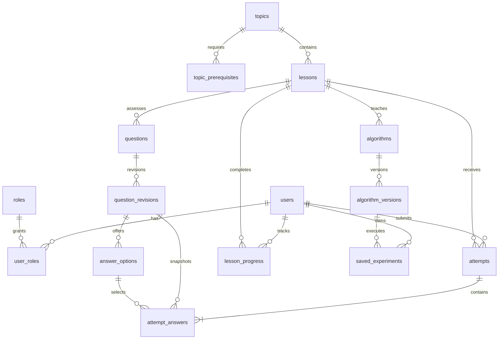

# Database design

MySQL 8.4 LTS; InnoDB, foreign keys and checked constraints. Flyway is authoritative; Hibernate validates and never creates production tables. V1 creates the schema and report view; V2 seeds all 14 released modules, their prerequisite edges, immutable version metadata and one concept assessment per module. Seed generation is deterministic from `content/modules.json` (`python3 scripts/seed-content.py`). Do not rewrite a migration after release: add V3+ for future content.

## Data dictionary

All IDs are auto-increment BIGINT primary keys unless a composite primary key is listed. Columns are NOT NULL. Database-generated timestamps use microsecond precision. Times returned by the API are instants/UTC. No raw passwords or execution frames are stored.

| Table | Columns and meaning | Relationships / constraints |
|---|---|---|
| users | id; email VARCHAR(254); display_name VARCHAR(80); password_hash VARCHAR(100); created_at TIMESTAMP(6) | Unique lowercase email; BCrypt cost 12 |
| roles | id; name VARCHAR(32) | Unique STUDENT / INSTRUCTOR names |
| user_roles | user_id, role_id | Composite PK; both FKs |
| topics | id; slug VARCHAR(64); title VARCHAR(100) | Unique stable module slug |
| topic_prerequisites | topic_id, prerequisite_id | Composite PK; topic FKs; no direct self-edge; curriculum review prevents cycles |
| lessons | id; topic_id; slug VARCHAR(64); title VARCHAR(100); body TEXT | Topic FK; unique slug |
| algorithms | id; lesson_id; slug VARCHAR(64); title VARCHAR(100) | Lesson FK; unique slug; initial numeric IDs match protocol module IDs |
| algorithm_versions | id; algorithm_id; version VARCHAR(32); engine_version VARCHAR(32); complexity TEXT; invariants TEXT | Unique (algorithm_id,version); append new versions |
| questions | id; lesson_id; stable_key VARCHAR(100) | Lesson FK; unique stable key |
| question_revisions | id; question_id; revision INT; prompt TEXT; explanation TEXT | Unique (question_id,revision); append-only application contract |
| answer_options | id; revision_id; ordinal INT; text VARCHAR(1000); is_correct BOOLEAN | Unique (revision_id,ordinal); revision FK; exactly one correct option in released content |
| attempts | id; user_id; lesson_id; score INT; total INT; created_at TIMESTAMP(6) | User/lesson FKs; 0 ≤ score ≤ total; server-generated score |
| attempt_answers | id; attempt_id; revision_id; selected_option_id; is_correct; prompt_snapshot, selected_snapshot, correct_snapshot, explanation_snapshot TEXT | Attempt/revision FKs; composite option/revision FK; unique (attempt_id,revision_id) |
| lesson_progress | id; user_id; lesson_id; completion INT; updated_at TIMESTAMP(6) | Unique (user_id,lesson_id); completion in 0..100 |
| saved_experiments | id; user_id; algorithm_version_id; title VARCHAR(120); input_json JSON; configuration_json JSON; engine_version VARCHAR(32); created_at TIMESTAMP(6) | Owner/version FKs; bounded JSON payloads; no animation history |

`ix_attempts_user_created` and `ix_experiments_owner_created` support private owner/history access. `ix_answers_revision_correct` supports the instructor view. Foreign-key indexes are created by MySQL where needed. The release is small; measure real query plans before adding more indexes.

## Transactions and history

Registration inserts a user and its student role atomically. Official assessment submission requires exactly one answer per current revision for the selected lesson. A transaction inserts the attempt, validates every selected option, computes the score from answer_options, saves immutable textual snapshots, and updates the attempt score. Any invalid option rolls back the entire transaction. Historical attempt details read snapshots; old revisions/options remain referenced, even if new revisions are published. No content-editing REST endpoint exists in this release; content changes use reviewed append-only migrations.

Checkpoints use an atomic MySQL upsert with `GREATEST(existing,submitted)` so replayed/offline submissions cannot lower completion. Exploration is 50%; correct guest practice is 75%; correct official assessment is 100%. Completion is a learning activity indicator, not an authoritative assessment score. Official scores live only in attempts.

Guest checkpoints live in IndexedDB under the guest owner. Login merges guest and that account's pending checkpoints into the server by maximum completion. A local checkpoint is acknowledged only after a successful response and only if it has not been superseded. Failed synchronization retains the checkpoint. Saved guest experiments are uploaded only by an explicit “Upload copy”; they do not merge automatically. Private remote experiments are fetched with the current session and are not cached in the guest store. Use separate browser profiles on shared devices to isolate local guest data.

## Instructor report

`difficult_questions` groups answers by module, stable question key and revision, showing answer count, missed count and miss percentage. `GET /api/reports/difficult-topics` is instructor-only and paginated. Counts are descriptive and can be sparse; they do not establish causation or educational efficacy. See [SQL examples](sql-examples.sql) for a topic-level aggregation. Provision an instructor deliberately with an administrative SQL transaction; registration always grants STUDENT only.
